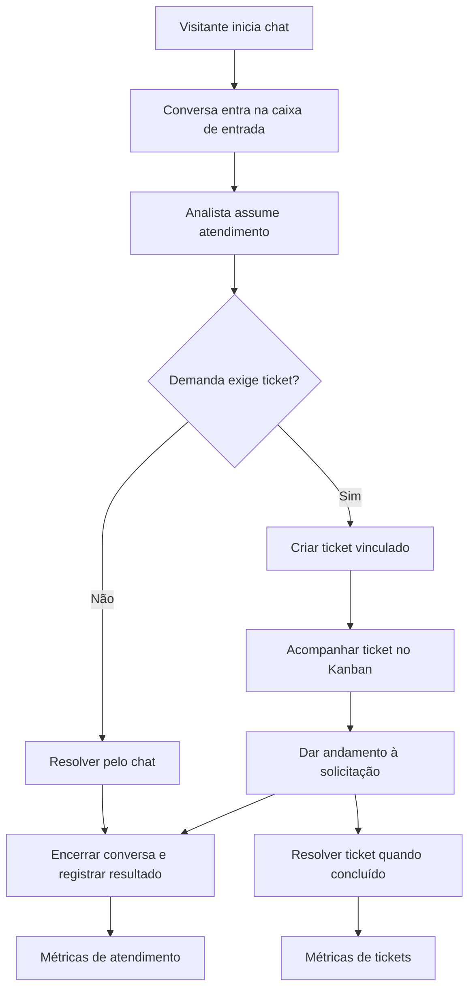

# FluxDesk

**Documento de definição e detalhamento do produto**  
**Versão:** 1.1  
**Status:** definição funcional inicial — sujeito a refinamentos durante o desenvolvimento  
**Modelo:** software open source

## 1. Visão geral

O **FluxDesk** é uma plataforma open source de **help desk e atendimento ao cliente** para organizações, empresas, equipes de suporte e desenvolvedores. Seu objetivo é centralizar os contatos recebidos por um **chat ao vivo incorporável** a sites e aplicações, facilitar o trabalho dos analistas e permitir que solicitações que exigem acompanhamento sejam formalizadas em **tickets gerenciados por Kanban**.

A plataforma oferece dois fluxos complementares:

- **Atendimento por conversa:** uma dúvida ou solicitação pode ser respondida e concluída inteiramente pelo chat, sem abertura de ticket.
- **Atendimento com ticket:** quando a demanda exige investigação, execução posterior ou acompanhamento, o analista pode criar um ticket associado à conversa.

A decisão de abrir um ticket é **do analista de suporte**. **Receber uma nova conversa não gera automaticamente um ticket.** O sistema deve permitir registrar o desfecho do atendimento e, quando cabível, confirmar que ele foi concluído com sucesso.

### 1.1 Proposta de valor

Fornecer uma experiência de suporte simples para o visitante e uma operação organizada para a equipe, integrando **comunicação em tempo real, distribuição de atendimentos, gestão de tickets, colaboração interna e métricas operacionais** em um só ambiente.

### 1.2 Público-alvo

- Pequenas e médias empresas com equipe de suporte.
- Produtos SaaS e aplicações web que precisam incorporar atendimento ao próprio produto.
- Desenvolvedores independentes e mantenedores de projetos.
- Organizações que desejam uma alternativa open source e auto-hospedável.

### 1.3 Limites da proposta inicial

O canal principal da primeira versão é o **widget de chat web**. A interface pode ser inspirada em mensageiros conhecidos, mas não depende de integração nativa com WhatsApp. Integrações com WhatsApp, e-mail, redes sociais e agentes de IA são possibilidades futuras, não requisitos do MVP.

---

## 2. Conceitos do domínio

| Conceito | Definição |
|---|---|
| **Organização / workspace** | Ambiente de uma empresa, com sua própria equipe, configurações, conversas e tickets. |
| **Contato / visitante** | Pessoa que inicia ou participa de atendimento no widget. Pode ser identificada ou iniciar como visitante, conforme a configuração futura de identificação. |
| **Analista / agente** | Integrante da equipe que atende conversas e administra tickets segundo suas permissões. |
| **Conversa / atendimento** | Canal de comunicação entre o visitante e o suporte; possui mensagens, responsável, estado e desfecho próprios. |
| **Ticket** | Registro estruturado de uma solicitação que exige acompanhamento. Pode nascer de uma conversa ou ser criado diretamente no painel. |
| **Nota interna** | Mensagem de colaboração entre analistas que não é enviada ao visitante. |
| **Resultado do atendimento** | Classificação registrada pelo analista ao encerrar uma conversa, permitindo métricas de sucesso sem exigir a existência de ticket. |
| **Evento de auditoria** | Registro de mudanças relevantes, como atribuições, alterações de status, criação de ticket e encerramento. |

**Distinção importante:** conversa e ticket são entidades independentes. Uma conversa pode terminar sem ticket; um ticket pode continuar aberto depois que a conversa for encerrada. O encerramento de uma conversa **não implica automaticamente** a resolução de seu ticket, nem o inverso.

---

## 3. Fluxo funcional de atendimento

### 3.1 Jornada principal

1. Uma organização configura seu workspace e incorpora o widget de chat a um site ou aplicação autorizada.
2. Um visitante abre o widget e inicia uma conversa descrevendo sua dúvida, problema ou solicitação.
3. O FluxDesk registra a conversa e a apresenta na **caixa de entrada compartilhada** da equipe.
4. Um analista assume a conversa ou recebe sua atribuição de outro membro da equipe.
5. O analista atende o visitante por chat, consulta o histórico e avalia se a demanda precisa de acompanhamento formal.
6. **Decisão: criar ticket?**
   - **Não:** o analista continua a conversa e tenta resolver a demanda no próprio chat.
   - **Sim:** o analista cria um ticket, vincula-o à conversa e define título, descrição, prioridade, responsável, categoria e prazo, quando aplicável. O ticket passa a ser acompanhado pelo Kanban.
7. Durante o atendimento, analistas podem trocar responsáveis, registrar notas internas e consultar o histórico das ações.
8. Quando a interação com o visitante terminar, o analista **encerra a conversa** e registra seu resultado.
9. Se um ticket tiver sido aberto, ele continua com ciclo de vida independente até ser efetivamente resolvido, cancelado ou reaberto, conforme as regras de negócio.
10. Os registros de resultado e os eventos do atendimento alimentam o painel de métricas.

> **Observação:** o diagrama resume um fluxo frequente. A conversa pode ser encerrada enquanto o ticket permanece aberto, e o ticket pode ser atualizado após o encerramento do chat.

### 3.2 Confirmação de sucesso do atendimento

Ao encerrar uma conversa, o analista deve registrar o resultado por meio de uma ação explícita. A interface pode exibir um botão **“Encerrar atendimento”** e solicitar a seleção de uma das opções:

- **Resolvido com sucesso:** a necessidade apresentada pelo visitante foi atendida.
- **Encerrado sem resolução:** não foi possível resolver a demanda naquele atendimento.
- **Encaminhado para acompanhamento:** a demanda segue em aberto, por exemplo, em um ticket ainda não concluído.

**Regras propostas:**

- O resultado da conversa pode ser registrado **mesmo quando não existe ticket**.
- Apenas encerrar o chat não deve contar automaticamente como sucesso.
- O sistema deve guardar **quem confirmou**, **quando confirmou** e o **resultado selecionado**.
- Ao escolher “Resolvido com sucesso”, o analista confirma uma **avaliação interna**, não uma validação feita pelo cliente.
- Se houver ticket pendente, a opção natural é “Encaminhado para acompanhamento”, e não “Resolvido com sucesso”, salvo quando se tratar de um ticket independente já sem pendências relacionadas à conversa.
- Uma conversa reaberta deve preservar o histórico; sua regra de recálculo de métricas precisa ser explícita. **Proposta inicial:** considerar o resultado mais recente da conversa, mantendo os resultados anteriores no histórico de eventos.
- O resultado pode ser corrigido por pessoa autorizada, com registro de auditoria, para evitar distorções nas métricas.

**Evolução futura:** disponibilizar uma confirmação do próprio visitante (“Meu problema foi resolvido”) e/ou pesquisa de satisfação (CSAT). Essas medidas devem ser exibidas **separadamente** da confirmação do analista, pois representam evidências diferentes.

### 3.3 Exemplo A — dúvida resolvida sem ticket

1. Visitante pergunta como alterar uma informação no sistema.
2. Analista assume e explica o procedimento.
3. Visitante informa que conseguiu concluir a alteração.
4. Analista encerra a conversa com resultado **Resolvido com sucesso**.
5. O atendimento entra nas métricas de conversas, **sem gerar ticket**.

### 3.4 Exemplo B — problema que exige ticket

1. Visitante relata um erro persistente na aplicação.
2. Analista investiga e identifica que a correção exige atuação técnica posterior.
3. Analista cria ticket a partir da conversa e informa o encaminhamento.
4. Analista encerra a conversa como **Encaminhado para acompanhamento**.
5. O ticket segue no Kanban até a resolução, preservando o vínculo com o histórico do atendimento.
6. A resolução posterior do ticket não transforma retroativamente a primeira conversa em “Resolvido com sucesso” sem uma regra de atualização explícita.

---

## 4. Funcionalidades do produto

### 4.1 Widget de chat incorporável

**Objetivo:** oferecer ao visitante um canal de suporte diretamente no site ou produto da organização.

**Funcionalidades:**

- Instalação por trecho de código/script fornecido no painel da organização.
- Botão flutuante que abre e fecha o chat.
- Envio e recebimento de mensagens em tempo real.
- Histórico da conversa durante a sessão e recuperação após reconexão.
- Identificação do contato quando necessária (nome e e-mail como campos iniciais possíveis).
- Exibição de mensagens e do estado básico do atendimento.
- Indicação visual de nova mensagem.
- Configuração de domínios autorizados para incorporar o widget.

**Evoluções:** personalização de tema, logo e textos; formulário pré-chat; anexos; identificação segura do usuário autenticado do site integrador; contexto de página e módulo.

### 4.2 Caixa de entrada compartilhada

**Objetivo:** concentrar os atendimentos recebidos e permitir atuação coordenada da equipe.

**Funcionalidades:**

- Visualização de conversas novas, em atendimento e encerradas.
- Filtros por responsável, status e mensagens não lidas.
- Visualização do histórico de mensagens e dos dados do contato.
- Ações para **assumir**, **transferir** e **encerrar** atendimento.
- Identificação clara do analista responsável.
- Acesso rápido para **criar ticket vinculado** e visualizar tickets relacionados.
- Registro de **resultado do atendimento** no encerramento.
- Notificações dentro do painel para novas mensagens e atribuições.

**Regra:** para evitar atendimento duplicado, cada conversa deve ter, no máximo, um analista responsável principal por vez, embora outros colaboradores autorizados possam consultar seu histórico.

### 4.3 Gestão de tickets e Kanban

**Objetivo:** organizar demandas que precisam ser acompanhadas além da conversa imediata.

**Operações:** criar, consultar, editar, atribuir, movimentar, resolver, reabrir e cancelar tickets, de acordo com as permissões da equipe.

**Campos iniciais:**

| Campo | Descrição |
|---|---|
| ID | Identificador único do ticket dentro de sua organização. |
| Título | Resumo objetivo da solicitação. |
| Descrição | Problema, dúvida ou atividade a executar. |
| Contato | Pessoa associada à solicitação, quando conhecida. |
| Conversa de origem | Vinculação opcional ao atendimento que originou o ticket. |
| Responsável | Analista encarregado do acompanhamento. |
| Prioridade | Baixa, média, alta ou urgente. |
| Categoria | Classificação como bug, dúvida, melhoria ou financeiro; configurável em evolução futura. |
| Prazo | Data limite opcional. |
| Status | Etapa atual do fluxo. |
| Datas | Criação, última atualização e resolução, quando aplicável. |

**Colunas iniciais do Kanban:** **Aberto → Em andamento → Aguardando cliente → Resolvido**. Tickets cancelados ficam acessíveis em filtros e histórico, sem precisar ocupar uma coluna principal.

**Regras:**

- Criar ticket **não é obrigatório** para encerrar um atendimento.
- Tickets podem ser criados diretamente no painel, mesmo sem conversa de origem.
- Alterações de status, prioridade e responsável geram histórico de atividades.
- Um ticket resolvido pode ser reaberto por ação autorizada.
- Movimentar um ticket para “Resolvido” exige registrar a resolução ou ao menos uma observação conclusiva (regra funcional recomendada).

### 4.4 Gestão de equipes, agentes e permissões

- Criar e gerenciar integrantes de cada organização.
- Definir papéis iniciais: **Administrador** e **Analista**.
- Autenticar membros da equipe antes do acesso ao painel.
- Permitir atribuição e transferência de conversas e tickets.
- Garantir que usuários de organizações diferentes não acessem dados uns dos outros.

**Papéis iniciais sugeridos:** Administrador gerencia equipe e configurações; Analista atende conversas e opera tickets conforme as permissões estabelecidas.

### 4.5 Notas internas e histórico de atividades

- Permitir registrar comentários internos em tickets, não visíveis ao visitante.
- Manter histórico de criação, atribuição, transferência, alteração de prioridade, movimentação e encerramento.
- Registrar autor e horário de cada evento relevante.
- Diferenciar na interface **mensagens externas do chat** de **notas e eventos internos**.

### 4.6 Categorias, etiquetas, busca e filtros

- Categorizar tickets por natureza da solicitação.
- Aplicar etiquetas para refinamento da organização interna.
- Buscar tickets por ID, título e contato; buscar conversas por contato quando identificado.
- Filtrar conversas e tickets por status, responsável, prioridade e categoria quando disponível.

**Prioridade de entrega:** filtros e busca básicos entram no MVP; a edição de categorias e etiquetas personalizadas pode ser disponibilizada logo após o MVP.

### 4.7 Notificações

- Notificação interna de nova conversa disponível.
- Notificação para analista quando houver mensagem nova em atendimento de sua responsabilidade.
- Notificação em transferência ou atribuição de ticket.
- Exibição de contadores de conversas não lidas.

**Evoluções:** alertas por e-mail, notificações push e regras de escalação.

---

## 5. Indicadores e métricas

O FluxDesk deverá permitir avaliar a operação por **conversas** e por **tickets**, sem confundir essas duas unidades.

### 5.1 Métricas de atendimento (conversas)

| Métrica | Definição proposta |
|---|---|
| Atendimentos recebidos | Quantidade de conversas iniciadas no período. |
| Atendimentos encerrados | Quantidade de conversas encerradas no período. |
| Atendimentos com sucesso confirmado | Conversas cujo resultado mais recente foi “Resolvido com sucesso”, conforme o recorte temporal adotado. |
| Taxa de sucesso declarada pelo analista | Conversas encerradas como “Resolvido com sucesso” ÷ conversas encerradas com resultado registrado × 100. |
| Encerrados sem resolução | Conversas encerradas como “Encerrado sem resolução”. |
| Encaminhados para acompanhamento | Conversas encerradas como “Encaminhado para acompanhamento”. |
| Tempo até primeira resposta humana | Intervalo entre o início da conversa e a primeira mensagem enviada por um analista. |
| Tempo de atendimento | Intervalo entre início e encerramento de uma conversa; não equivale necessariamente ao tempo de trabalho ativo. |
| Atendimentos por analista | Quantidade de conversas atendidas ou encerradas por responsável no período, com critério consistente. |

**Atenção à interpretação:** a taxa de sucesso descrita é **autodeclarada pela equipe**. Não equivale à satisfação ou à confirmação do cliente e não deve ser rotulada como CSAT. O painel deve informar qual intervalo de datas está sendo utilizado e, preferencialmente, separar conversas ainda abertas das encerradas.

### 5.2 Métricas de tickets

- Tickets abertos, em andamento, aguardando cliente e resolvidos.
- Tickets criados e resolvidos por período.
- Distribuição por prioridade, categoria e responsável.
- Tempo médio de resolução, considerando apenas tickets resolvidos.
- Tickets vencidos (quando houver prazo configurado).
- Taxa de tickets reabertos.

### 5.3 Implementação gradual

**MVP:** armazenar os eventos e resultados necessários para calcular as métricas; disponibilizar contadores essenciais no painel.  
**Pós-MVP:** gráficos por período, filtros avançados, relatórios históricos e exportação.

---

## 6. Regras de negócio prioritárias

1. **Conversa não é ticket:** um atendimento existe independentemente de haver ticket.
2. **Criação manual:** o analista decide se abre um ticket; o sistema pode sugerir essa ação futuramente, mas não a executa automaticamente no MVP.
3. **Desfecho explícito:** encerrar uma conversa exige escolher seu resultado, para viabilizar métricas confiáveis.
4. **Sucesso não é encerramento:** só se contabiliza sucesso quando “Resolvido com sucesso” é selecionado.
5. **Sucesso declarado não é satisfação do cliente:** eventuais confirmações do visitante terão indicador próprio.
6. **Ciclos de vida separados:** encerrar uma conversa não resolve tickets associados e resolver tickets não encerra conversas automaticamente.
7. **Atribuição principal única:** uma conversa pode ter um responsável principal por vez.
8. **Rastreabilidade:** mudanças importantes e correções de resultados precisam de histórico.
9. **Isolamento organizacional:** mensagens, contatos, agentes, configurações e tickets pertencem ao workspace correspondente.
10. **Visibilidade apropriada:** notas internas e ações administrativas não são expostas no widget do visitante.

---

## 7. Requisitos não funcionais

### 7.1 Segurança e privacidade

- Autenticação e autorização para acesso interno; verificação de permissões no backend.
- Isolamento dos dados entre organizações (**multi-tenancy**).
- Validação de entradas, tratamento seguro de conteúdo das mensagens e medidas contra abuso e spam no widget.
- Restrições de origem/domínios permitidos, sem tratar restrição de domínio como substituto de autenticação e autorização.
- Coleta mínima e mecanismos de retenção/exclusão de dados pessoais, com atenção à LGPD.
- Logs sem exposição inadvertida de credenciais, tokens ou dados pessoais sensíveis.

### 7.2 Confiabilidade e experiência

- Troca de mensagens em tempo real com reconexão após queda de conexão.
- Persistência de mensagens, resultados, tickets e eventos relevantes.
- Recuperação do histórico após atualização da página, segundo a política de identificação da sessão.
- Identificadores e mecanismos para evitar mensagens duplicadas em tentativas de reenvio.
- Interface responsiva para painel e widget, com estados claros de carregamento e erro.

### 7.3 Projeto open source

- Repositório público com instruções de instalação e configuração.
- Licença explicitamente escolhida, conforme o modelo de distribuição desejado.
- Exemplo de variáveis de ambiente e instruções de execução local.
- Documentação de contribuição e um caminho viável para auto-hospedagem.

---

## 8. Modelo de dados conceitual

Estas entidades representam responsabilidades do domínio; **não constituem ainda o esquema definitivo do banco de dados**.

| Entidade | Papel principal |
|---|---|
| `Organization` | Isolamento e configuração do workspace. |
| `User` / `Membership` | Identidade do colaborador, organização e permissões. |
| `Contact` | Identificação do visitante ou cliente. |
| `Conversation` | Atendimento, responsável, status e vínculo ao contato. |
| `Message` | Mensagem do chat, remetente, conteúdo e data/hora. |
| `ConversationOutcome` | Resultado do encerramento, analista que o registrou e data/hora; permite histórico de correções. |
| `Ticket` | Solicitação com status, prioridade, responsável, prazo e vínculo opcional à conversa. |
| `TicketEvent` | Eventos e alterações relevantes de um ticket. |
| `InternalNote` | Comentário privado de colaboração da equipe. |
| `Tag` / `Category` | Classificação de tickets e, futuramente, conversas. |
| `Notification` | Avisos destinados aos analistas. |
| `WidgetConfig` | Configurações e domínios autorizados do widget. |

**Relacionamentos iniciais sugeridos:** uma organização tem vários contatos, agentes, conversas e tickets; um contato pode ter várias conversas; uma conversa tem várias mensagens e pode originar um ou mais tickets no futuro. **Para simplificar o MVP**, admitir um ticket vinculado à conversa de origem por vez, sem impedir que essa cardinalidade seja ampliada em versões posteriores. Um ticket também pode existir sem conversa.

---

## 9. Escopo do MVP e prioridades

### 9.1 MVP — primeira versão funcional

**Fundação:** organizações, autenticação, permissões, agentes e contatos.  
**Atendimento:** widget instalável, conversa, mensagens em tempo real, histórico básico e caixa de entrada.  
**Operação:** atribuição/transferência, encerramento com resultado obrigatório, notificações internas e histórico de ações.  
**Tickets:** criação manual com vínculo opcional à conversa, Kanban, responsáveis, prioridade, prazo e movimentação de status.  
**Colaboração:** notas internas nos tickets.  
**Consulta:** filtros, busca básica e contadores essenciais de atendimento.  
**Entrega:** testes de fluxos críticos, documentação e instalação local.

### 9.2 Evoluções após o MVP

- Categorias e etiquetas configuráveis pela organização.
- Respostas prontas e macros.
- Anexos com limites e regras de acesso.
- Personalização do widget, formulários pré-chat e presença dos atendentes.
- Metas de SLA e alertas de vencimento.
- Relatórios históricos detalhados e exportação de dados.
- Pesquisa de satisfação/CSAT com confirmação do visitante.
- Base de conhecimento e artigos de autoatendimento.
- Automação de atribuições, prioridades e escalonamentos.
- API pública, webhooks e SDK de integração.
- Informações contextuais da aplicação integradora, com privacidade por padrão.
- IA para sugerir respostas, resumir conversas ou auxiliar na criação de tickets; confirmação humana mantida nas ações relevantes.
- Canais adicionais, como e-mail e integrações de mensageria.

---

## 10. Critérios de aceitação da primeira versão

O MVP poderá ser considerado funcional quando:

1. Uma organização conseguir configurar o ambiente e incorporar o widget em uma página de teste.
2. Um visitante iniciar conversa e um analista responder em tempo real.
3. O histórico básico de mensagens continuar disponível após uma reconexão.
4. Um analista conseguir assumir e transferir uma conversa.
5. Um analista conseguir **encerrar com sucesso, encerrar sem resolução ou encaminhar para acompanhamento**, inclusive sem criar ticket.
6. A opção **“Resolvido com sucesso”** for persistida com data/hora e analista responsável e repercutir no contador adequado.
7. O analista conseguir criar um ticket associado à conversa e movê-lo pelo Kanban.
8. Uma conversa puder ser encerrada enquanto o ticket associado permanece aberto.
9. As notas internas não forem exibidas para o visitante.
10. Uma organização não conseguir acessar dados de outra.
11. Os fluxos essenciais estiverem cobertos por testes automatizados e o projeto possuir documentação de execução.

---

## 11. Roadmap sugerido

| Fase | Entrega |
|---|---|
| **1 — Fundação** | Workspace, autenticação, autorização, membros e contatos. |
| **2 — Tickets** | CRUD, responsáveis, estados, Kanban e auditoria básica. |
| **3 — Atendimento** | Widget web, conversas, mensagens em tempo real, caixa de entrada e atribuições. |
| **4 — Fluxo completo** | Decisão manual de criar ticket, vínculo chat-ticket, notas internas, encerramento e confirmação de sucesso. |
| **5 — Qualidade e lançamento** | Métricas essenciais, testes, proteção de dados, documentação e primeira release pública. |
| **6 — Expansão** | Automações, personalização, relatórios, integrações e IA. |

As fases representam uma **ordem de implementação sugerida**, não prazos ou compromissos de lançamento.

---

## 12. Decisões ainda em aberto

Os pontos abaixo devem ser discutidos antes da implementação definitiva das respectivas áreas:

- **Hospedagem:** apenas self-hosted no início ou também oferta cloud gerenciada?
- **Identificação:** visitante anônimo com sessão temporária, nome/e-mail obrigatório ou identidade transmitida pelo site integrador?
- **Disponibilidade:** atendimento exclusivamente humano ou mensagem automática fora do horário?
- **Reabertura:** o visitante pode reabrir uma conversa encerrada? Por quanto tempo? Como isso afeta o resultado registrado?
- **Vínculos:** o MVP mantém um único ticket de origem por conversa ou já aceita múltiplos?
- **Taxonomia:** categorias predefinidas ou totalmente configuráveis desde o início?
- **Retenção:** quanto tempo guardar mensagens, identificadores e registros operacionais?
- **Permissões:** analistas podem corrigir resultados próprios ou apenas administradores?
- **Métricas:** aplicar recortes por data de abertura, data de encerramento ou ambas, de modo claramente identificado?
- **Licença:** MIT, Apache-2.0 ou AGPLv3, entre outras possibilidades, conforme os objetivos de distribuição e contribuição?

---

## 13. Diretriz de produto

O FluxDesk deve priorizar uma experiência **rápida, compreensível e prática** tanto para o visitante quanto para o analista. Seu diferencial inicial não será a quantidade de funções, mas a integração coerente entre **chat, acompanhamento de solicitações e clareza dos resultados do atendimento**.

**Princípio central:** *nem toda conversa precisa virar ticket; todo atendimento deve poder ter um desfecho registrado e mensurável.*
